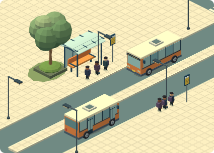

# Narrowcast Bustijden



Actuele bustijden voor haltes bij onze school, bedoeld voor de narrowcastschermen.

## Gebruik

1. Clone of download de repository.
2. Host de bestanden met een webserver, bijvoorbeeld Live Server in Visual Studio Code. Een buildstap is niet nodig.
3. Open de site in je browser.

Op localhost wordt voorbeelddata voor `BdOud` gebruikt. Op een gehoste site worden actuele tijden via de [OVapi-proxy](https://bustijden.curio.codes/) opgehaald. Voor actuele tijden is een internetverbinding nodig.

## Andere haltes

Standaard toont de site haltegebied `BdOud`. Kies een ander haltegebied via de URL:

```text
?stopAreaCode=BdLov
```

Met `routeA` en `routeB` bepaal je de volgorde van de twee haltes:

```text
?stopAreaCode=BdLov&routeA=72001080&routeB=72001330
```

De haltegebied- en haltecodes vind je bij [OVapi](http://v0.ovapi.nl/stopareacode).

## Weergave

Voeg `?compareStyles=1` toe aan de URL om een scènestijl te kiezen. Je kunt ook direct `?sceneStyle=original`, `?sceneStyle=clean`, `?sceneStyle=dither` of `?sceneStyle=ink` gebruiken. Combineer opties met `&`.

Met `?background=1` zie je alleen de achtergrond, zonder de vertrektijden. Handig voor een screenshot van de omgeving.

Voor de 3D-achtergrond is WebGL 2 nodig. Zonder WebGL 2 blijven de vertrektijden beschikbaar.

Loopt de achtergrond schokkerig op een zwak scherm? Voeg dan `?quality=low` toe. De 3D-achtergrond wordt dan op maximaal 1280×720 pixels en zonder anti-aliasing getekend.
