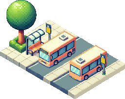

# Narrowcast Bustijden



Bus tijden voor de bushaltes in de buurt van onze school. Gemaakt voor de narrowcast schermen in de school.

## API

De API waar we gebruik van maken is de [`ovapi`](http://v0.ovapi.nl/stopareacode/BdOud). We maken gebruik van [een proxy server](http://bustijden.curio.codes/) (zie `proxy.php`) om deze HTTP-API naar HTTPS om te zetten en om onze eigen `CORS` headers toe te voegen.

## Gebruik

1. Clone de repository

2. Om te zorgen dat de test-data kan laden, moet je het project hosten op localhost. Gebruik bijvoorbeeld de [Live Server](https://marketplace.visualstudio.com/items?itemName=ritwickdey.LiveServer) extensie in Visual Studio Code.

3. Open de site in je browser

Zie het commentaar in de `index.html` voor meer informatie.

## Andere routes

Standaard wordt de route `BdOud` gebruikt. Je kunt dit aanpassen door de `stopAreaCode` in de URL aan te passen:

```
?stopAreaCode=BdLov
```

Als je de ook de volgorde van haltes (welke boven of onder staat) wilt aanpassen kun je `routeA` en `routeB` aangeven:

```
?stopAreaCode=BdLov&routeA=72001080&routeB=72001330
```

Gebruik de [ovapi](http://v0.ovapi.nl/stopareacode) om alle bushaltes in de buurt van jouw locatie te vinden. Vervolgens staan de `routeA` en `routeB` codes onder de root stopAreaCode node.

## Procedurele 3D-scène

De halte, bussen, studenten, kleding en feestdagdecoraties worden opgebouwd uit eenvoudige 3D-vormen in
`js/models3d.js`. `js/scene3d.js` tekent deze met WebGL 2 en een orthografische camera onder een isometrische
hoek. De scène laadt geen sprites of texturen; de oude sprites en het Paint.NET-bronbestand zijn verwijderd.
In `assets/` staat alleen nog het logo dat bovenaan deze README wordt gebruikt.
Three.js 0.182.0 staat lokaal in `js/vendor/`, inclusief MIT-licentie. De site heeft geen buildstap nodig.

Voor narrowcastschermen is de animatie begrensd op 30 fps en maximaal 1920 × 1080 renderpixels, ook op
een 4K-scherm. Gedeelde geometrie en GPU-instancing houden het aantal draw calls klein bij grote groepen.
De wachtrij is begrensd op 300 studenten per richting; vertrokken bussen en ingestapte studenten worden
verwijderd. Animatielussen pauzeren wanneer het tabblad verborgen is. Regen, sneeuw en vuurwerk blijven
lichte canvasdeeltjes. Zonder WebGL 2 blijven de vertrektijden beschikbaar.

Inspecteer `scene3d.getStats()` in de browserconsole voor draw calls, driehoeken, GPU-resources en
renderresolutie. Gebruik bijvoorbeeld `?fakeTime=2026-11-20T12:00:00%2B01:00` op localhost om Sinterklaas
te bekijken. Feestdagen blijven geregistreerd in `js/events/`; decoraties en kleding verwijzen nu naar
`model` en `models` in plaats van afbeeldingsbestanden. Posities gebruiken vaste layoutcoördinaten,
zodat een resize bestaande animaties niet verplaatst.

Met `?compareStyles=1` verschijnt een keuzelijst voor de scènestijl. De keuze staat in de URL en blijft
bij herladen behouden; zonder `sceneStyle` blijft de originele 3D-weergave actief. Direct vergelijken:

| URL | Stijl |
| --- | --- |
| `?sceneStyle=original&compareStyles=1` | Originele 3D-weergave |
| `?sceneStyle=clean&compareStyles=1` | Heldere pixels: fijne pixels en subtiel beperkte kleuren |
| `?sceneStyle=dither&compareStyles=1` | Warm raster: grove pixels, warmere kleuren en geordend raster |
| `?sceneStyle=ink&compareStyles=1` | Pixelinkt: grove pixels, kleurvlakken en donkere binnencontouren |

Op 1920 × 1080 rendert `clean` op 960 × 540 en `dither`/`ink` op 640 × 360. De browser vergroot de
scène met scherpe pixels; de vertrektijden en weereffecten behouden hun eigen resolutie. Op grotere
schermen groeit de pixelgrootte mee om hetzelfde renderbudget te bewaren. De camera kijkt onder 30°
op de grond: diagonalen langs de wereldassen volgen daardoor een vast 2:1-pixelpatroon. Vergroting
gebruikt hele pixels; bij afwijkende schermmaten valt de kleine overmaat buiten beeld. Schuine daken,
gedraaide objecten en rondingen kunnen andere trappatronen hebben. Iedere pixelstijl gebruikt
één kleine kleurtextuur en één extra GPU-pass; alleen `ink` leest vier buurpixels voor contouren.
Er zijn geen CPU-pixelbewerkingen of extra geometriepassen. `getStats()` telt alle draw calls samen
en toont `style`, `pixelScale`, `postPasses` en de werkelijke renderresolutie. Vergelijk op het
narrowcastapparaat zelf: lagere resolutie bespaart fragmentwerk, maar de stad houdt hetzelfde aantal
driehoeken en instanties. `scene3d.setStyle('clean')` wisselt ook zonder keuzelijst.

De stad vult het hele scherm met doorlopende bestrating, zijstraten, gebouwen en groene pleinen.
De camera blijft op dezelfde halte gericht. De straten begrenzen samenhangende bouwblokken: volledig
bebouwd, volledig park, of een rechte verdeling met de helft bebouwing en de helft park. Gebouwen staan
in aaneengesloten rijen; parken hebben één doorlopend gazon met gedeelde wandelpaden. De indeling is
deterministisch: bij een resize blijven dezelfde gebouwen, bomen en parken op dezelfde plekken staan.
Bestrating gebruikt een procedureel
tegelpatroon; er worden geen losse meshes voor iedere tegel aangemaakt. De statische stad wordt alleen
opnieuw opgebouwd bij een resize of feestdagwissel en deelt de instancing-batches met de decoraties.

Een feestdag kan naast `props` bij de halte ook `cityProps` registreren:

```js
cityProps: [
  { model: 'sinterklaas/present1', height: 40, count: 12,
    placements: ['roof', 'park', 'pavement'] },
  { model: 'sinterklaas/sinterklaas', height: 120, count: 1,
    placements: ['roof'], unique: true },
]
```

De plaatsing houdt rekening met dakhoogtes, straten, andere decoraties en de vrije ruimte rond de halte.
Sinterklaas staat precies één keer op een dak. `scene3d.getStats()` toont ook het aantal gebouwen,
groene kavels en stadsdecoraties.

`js/lighting3d.js` regelt de kleuren van de 3D-scène: warm bij zonsondergang, paars in de avond,
koel en minder verzadigd in de nacht, roze bij zonsopkomst en helder overdag. De overgang gebruikt
de bestaande seizoensafhankelijke zonnetijd en wordt iedere seconde bijgewerkt. Straatlampen dimmen
vanzelf overdag en verlichten na zonsondergang de bestrating, bomen en gevels. Bussen hebben witte
koplampbundels en rode achterlichten die met de bus meebewegen en meevervagen.

Deze verlichting gebruikt vaste shaderberekeningen voor de dichtstbijzijnde lampkolommen en maximaal
twee bussen, met gedeelde instancing-batches voor lichtarmaturen en zachte gloed. Er zijn geen
schaduwkaarten, bloom-passen of aparte realtime lichtobjecten per lantaarnpaal nodig. `scene3d.getStats()`
toont ook `phase`, `saturation`, `nightLights`, `streetLights` en `busLights`.
Bekijk bijvoorbeeld `?fakeTime=2026-11-20T23:00:00%2B01:00` voor nacht; op die datum geven 08:45,
16:45 en 17:30 respectievelijk ochtendlicht, zonsondergang en avondlicht.

De browsertest controleert onder meer 600 zichtbare studenten, feestdagwisselingen, opruimen van
animaties, schermvullende grond, stabiele plaatsing van stadsdecoraties, portret/4K/brede resizes en
pauzeren bij een verborgen tabblad. De test controleert ook de vijf lichtfases, licht op het wegdek,
meebewegende koplampen, rode achterlichten en het vaste renderbudget:

```sh
npm ci
npx playwright install chromium
npm test
```

Met `PLAYWRIGHT_CHROMIUM_EXECUTABLE_PATH` kun je een bestaande Chromium-installatie gebruiken.
De bestaande Vue- en Tailwind-CDN's moeten bereikbaar zijn tijdens de test.
